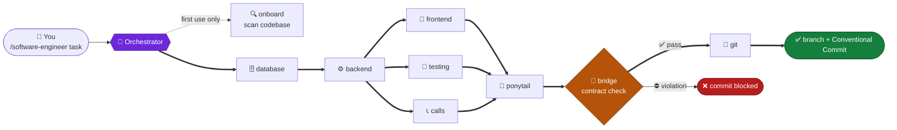
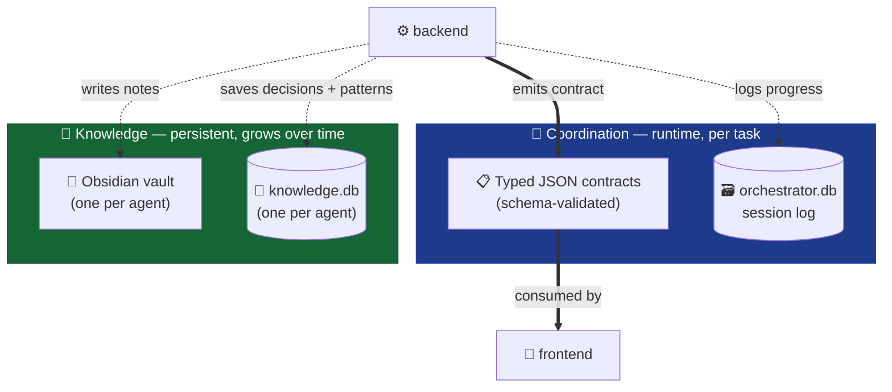
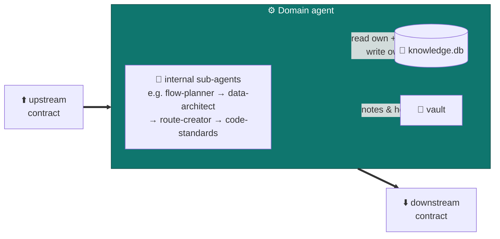

# Software Engineer

A multi-agent system that automates the full software development lifecycle — as a **Claude Code plugin** (the `/software-engineer` command) and as a **cross-IDE MCP server** (Cursor, Windsurf, VS Code, and other MCP editors).

One command. Every agent runs in sequence — database schema, backend routes, frontend components, Postman tests, inbound/outbound call systems, security scan, git commit. Each agent has its own SQLite knowledge base and Obsidian vault that grows smarter with every session.

---

## Install

In Claude Code, register this repo as a plugin marketplace, then install the plugin:

```
/plugin marketplace add MARafey/The-Software-Engineer
/plugin install software-engineer@software-engineer
```

That's it. Run `/software-engineer` — on first use it clones this repo to `~/.agents`, installs dependencies, and seeds the knowledge bases automatically.

> Why a plugin and not a loose file? Claude Code only loads skills that live in a folder as `skills/<name>/SKILL.md`. Dropping a single `software-engineer.md` into `~/.claude/skills/` will **not** register the slash command — the plugin packaging is what makes `/software-engineer` appear.

---

## Usage

```
/software-engineer <task>
```

```
/software-engineer add user authentication with JWT and refresh tokens
/software-engineer fix the broken /api/orders route returning 500
/software-engineer create a products table with categories and inventory
/software-engineer add a dashboard page showing sales statistics
/software-engineer generate Postman tests for all existing routes
/software-engineer add CSP and security headers to the backend
```

Other commands:
```
/software-engineer test         — run 48 health checks, verify install is working (no files modified)
/software-engineer onboard      — force re-scan of current project (auto-runs on first use)
/software-engineer status       — show recent sessions
/software-engineer update       — pull latest version
/software-engineer help         — show all commands
```

---

## Other editors (Cursor, Windsurf, VS Code) — MCP server

Not on Claude Code? The same orchestrator is exposed as an MCP server, so any MCP-capable editor can use it. After the engine is set up (clone + `npm run init` — see *How it works internally*), point the editor at `node ~/.agents/mcp/server.mjs`:

```json
{
  "mcpServers": {
    "software-engineer": { "command": "node", "args": ["~/.agents/mcp/server.mjs"] }
  }
}
```

Tools: `software_engineer_health`, `software_engineer_classify`, and `software_engineer_orchestrate` (plan by default; pass `apply: true` to write files). Reasoning uses the host's model via MCP sampling, or `ANTHROPIC_API_KEY` / `OPENAI_API_KEY` when sampling isn't available — no keys are bundled. Per-editor setup in [`mcp/README.md`](mcp/README.md).

---

## Before building anything, it asks you

Before writing code, the system asks plain-language questions to remove all guesswork:

- **Frontend tasks:** What colors? Top bar or side menu? Mobile-friendly?
- **Backend tasks:** JWT auth or sessions? Rate limiting? API versioning?
- **Database tasks:** Soft delete or hard delete? UUIDs or integers? Expected data size?

For each decision, it shows you its recommendation first and asks if you agree. You can answer all questions at once or just say "use your recommendations" to accept all defaults.

If you share a mockup image or screenshot, it reads it and only asks about the parts that are unclear — not generic "what do you want?" questions.

---

## What happens when you run a task

**First use on any project:** the system automatically scans your entire codebase before doing anything — routes, components, schema, conventions, security posture. This runs once per project and is stored in the agent knowledge bases. Every future session starts with that context already loaded.

Eight agents then run in dependency order:

```
[onboard — first use only] → database → backend → frontend + testing + calls (parallel) → ponytail → bridge → git
```

| | Agent | Does |
|--|-------|------|
| 🗄️ | **Database** | Writes migration SQL, validates foreign keys, adds indexes |
| ⚙️ | **Backend** | A *data-architect* first plans lean data access — a single shared DB pool, disciplined AI queries (read-only, `LIMIT` + filters, no `SELECT *`), caching/lookup tables — then routes, controllers, services with JSDoc |
| 🎨 | **Frontend** | An *art-director* sets the artistic vision (composition, palette, flow, cohesion — the eye of the masters) up front; an *atelier-curator* judges the finished UI as one piece. *layout / positioning / contrast* specialists handle complex CSS; 3D tasks invoke Opus for scene/physics/shader design. Builds components, wires API calls, enforces token/storage rules |
| 🧪 | **Testing** | Generates Postman collection (positive + negative + auth tests per route) |
| 📞 | **Calls** | Inbound IVR flows, outbound dialing campaigns, Twilio/Vonage webhooks, TTS scripts, TCPA/GDPR/DNC compliance |
| 🐴 | **Ponytail** | "Lazy senior dev" refinement gate — reviews the generated code against a minimal-code decision ladder (reuse > stdlib > native > deps > one-liner) and trims over-engineering. Never touches validation/security/accessibility. Advisory — never blocks |
| 🔗 | **Bridge** | Validates that frontend bindings and telephony webhooks match backend contracts; gates the commit |
| 🔐 | **Git** | Runs 10-point security scan, creates feature branch, writes Conventional Commit |

---

## 🏛️ System architecture

A top-level **orchestrator** 🧭 decomposes your task, auto-onboards the project on first use, then routes the work through specialized domain agents in a strict dependency order. Every agent is grounded by its own knowledge base, and they coordinate through typed contracts — never ad-hoc chatter.

### The orchestration pipeline



`frontend`, `testing`, and `calls` run **in parallel** after `backend`. `ponytail` trims the generated code, then the `bridge` re-validates every contract before `git` is allowed to commit.

### Two layers of communication

Agents talk through two distinct channels — they're kept deliberately separate:



- **🔄 Coordination (runtime):** each agent emits a typed JSON contract (`shared/contracts/*.schema.json`); the next agent consumes it. The 🔗 bridge validates them across domains and **blocks the commit** on any mismatch. Live progress is logged to `shared/orchestrator.db`.
- **🧠 Knowledge (persistent):** each agent reads and writes its **own** Obsidian vault 📓 + SQLite `knowledge.db` 💾. These survive across sessions, so the system gets smarter every run. Agents do **not** message each other through vault links — that's what contracts are for.

### Inside a single agent



Each domain agent runs its own internal pipeline of sub-agents (the 🎨 frontend, for example, runs `art-director → ui-designer → 3d-designer → layout/positioning/contrast → component-creator → api-request-handler → atelier-curator → security-checker`). Knowledge access is scoped by an ACL (`shared/lib/acl.js`): an agent may **write only its own** knowledge and **read its own + upstream** — e.g. frontend may read backend; ponytail may read backend/frontend/calls.

### See it live in Obsidian

Because every vault is cross-linked with `[[wikilinks]]`, opening the `~/.agents/agents/` folder as **one** Obsidian vault renders the entire system as a navigable graph — orchestrator hub → domain agents → sub-agents → per-task session notes. (More in [Knowledge bases](#knowledge-bases) below.)

### Icon legend

| Icon | Component | | Icon | Component |
|:--:|--|--|:--:|--|
| 🧭 | Orchestrator (coordinator) | | 🐴 | Ponytail (minimal-code gate) |
| 🔍 | Onboard (one-time codebase scan) | | 🔗 | Bridge (contract validation) |
| 🗄️ | Database agent | | 🔐 | Git / DevOps (security + commit) |
| ⚙️ | Backend agent | | 💾 | `knowledge.db` — per-agent SQLite |
| 🎨 | Frontend agent | | 🗃️ | `orchestrator.db` — session log |
| 🧪 | Testing agent | | 📓 | Obsidian vault — per-agent notes |
| 📞 | Calls agent | | 📋 | Typed JSON contract |

---

## Security rules (enforced before every commit)

The git agent blocks commits that contain:

- `.env` files
- Hardcoded API keys, passwords, or secrets
- Raw JWT/bearer tokens in source
- `localhost` URLs in non-test files
- Auth tokens read from `localStorage`
- Database credentials in `.js` or `.json`

---

## Knowledge bases

Each agent builds up its own Obsidian-compatible knowledge vault at `~/.agents/agents/<name>/vault/`.

```
🧭 ~/.agents/agents/orchestrator/vault/ Routing, dependency order, per-task session history
🗄️ ~/.agents/agents/database/vault/    Schemas, migrations, query optimization notes
⚙️ ~/.agents/agents/backend/vault/     Express patterns, security rules, route decisions
🎨 ~/.agents/agents/frontend/vault/    Art-direction (the masters' principles), design tokens, storage rules, 3D scene patterns
🧪 ~/.agents/agents/testing/vault/     Postman collections, test reports
📞 ~/.agents/agents/calls/vault/       IVR flows, campaign patterns, TTS scripts, TCPA/GDPR compliance
🐴 ~/.agents/agents/ponytail/vault/    Decision ladder, intensity modes, per-session review notes
🔗 ~/.agents/agents/mcpbridge/vault/   Contract validation history
🔐 ~/.agents/agents/gitdevops/vault/   Branch strategy, security scan results
```

### See the whole graph

The vaults are cross-linked with Obsidian `[[wikilinks]]`. To navigate the system as one
connected knowledge graph, **open the `~/.agents/agents/` folder itself as a single Obsidian vault**
(not an individual agent folder). You'll get:

- an **orchestrator** hub note linking to every domain agent, plus the dependency order;
- a **home note per agent** showing what it reads from (upstream), hands off to (downstream), and is validated by;
- **sub-agent** notes wired into each domain's internal pipeline (e.g. `flow-planner → route-creator → …`);
- **per-task session notes** the orchestrator writes in real time as work runs.

Open Obsidian's Graph View to see the agents and their contract flow as a live map.

---

## Requirements

- [Claude Code](https://claude.ai/code) — CLI or IDE extension
- [Node.js](https://nodejs.org) 18 or later
- [Git](https://git-scm.com)
- [Obsidian](https://obsidian.md) *(optional — for browsing agent knowledge bases)*

---

## How it works internally

You install the plugin once (see above). Everything else is handled automatically:

1. First `/software-engineer` invocation → skill clones this repo to `~/.agents/`
2. `npm install` fetches `better-sqlite3`, `uuid`, `chalk`, `ajv`, `@modelcontextprotocol/sdk`
3. `node init/bootstrap.js` creates all SQLite databases and contract schemas
4. `node init/seed-vaults.js` writes the initial Obsidian vault notes
5. All future runs go straight to the orchestration workflow

The agents communicate through typed JSON contracts validated against JSON Schema. The bridge agent blocks the git commit if any frontend↔backend or backend↔database contracts are inconsistent.

---

## Updating

```
/software-engineer update
```

Or manually:
```bash
cd ~/.agents && git pull origin master && npm install && node init/bootstrap.js && node init/verify.js
```
